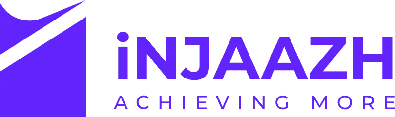

<div align="center">

  

  # ⚡ INJAAZH ERP OS
  ### The Intelligent, Executive-Grade Business Operating System

  [](https://nextjs.org/)
  [](https://react.dev/)
  [](https://www.typescriptlang.org/)
  [](https://tailwindcss.com/)
  [](https://www.mongodb.com/)
  [](https://developer.mozilla.org/en-US/docs/Web/API/Web_Audio_API)
  [](LICENSE)

  <p align="center">
    <strong>An all-in-one executive platform unifying Lead Generation, Financial Operations, Marketplace Client Hubs, Project Kanban Boards, and an AI Business Copilot with zero-latency audio feedback and glassmorphic aesthetics.</strong>
  </p>

  <p align="center">
    <a href="#-key-modules--architecture">Explore Modules</a> •
    <a href="#-lead-gen-operating-engine">Lead Gen Engine</a> •
    <a href="#-zero-latency-audio--notification-bus">Audio & Notification Bus</a> •
    <a href="#-tech-stack">Tech Stack</a> •
    <a href="#-quickstart--setup">Quickstart</a>
  </p>

</div>

---

## 💎 Overview

**INJAAZH ERP OS** is designed for modern agency founders, digital consultancies, and high-growth service businesses. Built ground-up with **Next.js 15 App Router** and **React 19**, it pairs ultra-fluid glassmorphism, dark/light Obsidian themes, keyboard-driven Command Center (`⌘K`), and an interactive Apple-style floating dock with an advanced native **Web Audio API** sound engine.

---

## 🚀 Key Modules & Architecture

```
┌─────────────────────────────────────────────────────────────────────────────┐
│                             INJAAZH ERP OS                                  │
├───────────────────┬───────────────────┬───────────────────┬─────────────────┤
│   LEAD GEN OS     │    FINANCIALS     │  MARKETPLACE CRM  │   AI COPILOT    │
│  • 11-Stage CRM   │  • Double Ledger  │  • Client Hub     │  • Multi-LLM    │
│  • Maps Audits    │  • Daily Expenses │  • Upwork/Fiverr  │  • Context Chat │
│  • Delivery SOPs  │  • Borrow & Lend  │  • Drag & Drop    │  • Auto-Audits  │
│  • Hourly Margin  │  • Invoices & Tax │  • Milestones     │  • Quota Shield │
├───────────────────┴───────────────────┴───────────────────┴─────────────────┤
│       CORE ENGINE: Zero-Latency Audio Bus + Command Center (⌘K) + RBAC      │
└─────────────────────────────────────────────────────────────────────────────┘
```

---

### 🎯 1. Lead Gen Operating Engine (`/lead-gen/*`)
A purpose-built, high-conversion outbound acquisition suite designed for agency growth:
* **Interactive 11-Stage Pipeline**: From `New` and `Verified` to `Audit Sent`, `Call Booked`, `Won`, and `Suppressed`.
* **Sub-Page Navigation**:
  * `/lead-gen/dashboard`: Real-time KPI summaries, conversion funnels, and revenue projections.
  * `/lead-gen/prospects`: Searchable, filterable directory with Google Maps ranking gap analysis and quick status flips.
  * `/lead-gen/daily-outreach`: Outbound email tracking, bounce monitors, reply rates, and positive response logs.
  * `/lead-gen/clients`: Active retainer management, hours billed, effective hourly rates (EHR), and churn tracking.
  * `/lead-gen/time-tracking`: Multi-lane time allocation (`Outreach`, `Fulfillment`, `Tech`, `Strategy`, `Admin`).
  * `/lead-gen/team-tasks`: Priority-sorted execution queues with due dates and assignments.
  * `/lead-gen/delivery-sops`: Standard Operating Procedures calendar, milestones, and deliverable checklists.
  * `/lead-gen/financials`: Retainer invoice generation, payment statuses, and operational expense logs.
  * `/lead-gen/settings`: Custom system defaults, cold email batch rules, and Excel import/export pipelines.

---

### 🔊 2. Zero-Latency Audio & Notification Bus
Engineered for tactile, instantaneous sensory feedback without lag:
* **Hardware Timeline Clock Scheduling**: Bypasses JavaScript event-loop scheduling (`setTimeout`) by leveraging native Web Audio API hardware timestamps (`ctx.currentTime + offset`).
* **3ms Ultra-Fast Attack Envelope**: Eliminates delay; sounds strike audibly within 3 milliseconds of a user click.
* **Pure Mathematical Synthesis**: No bulky MP3 or WAV audio assets—all tones, chords, chimes, and tactile clicks are synthesized in real-time with ADSR envelopes and chorus unison detuning.
* **Signature Sound Profiles**:
  * 🔔 **Crystal Two-Tone Chime**: Executive alert at 987 Hz (B5) and 1318 Hz (E6).
  * 💰 **Metallic Cash Register**: High-frequency harmonic chime for won deals & invoices.
  * 💸 **Acoustic Debit Chime**: Dual-tone 587 Hz (D5) & 440 Hz (A4) mallet for logged expenses.
  * ✨ **Sparkling Chime**: Rapid rising arpeggio for saved leads and updates.
  * 🔘 **Tactile Pop & Click**: 2ms micro-clicks for dock icons and modal actions.
* **Optimistic Local Notification Dispatch**: Topbar badge increments at `T = 0ms` with duplicate-alert suppression when MongoDB background syncing finishes.

---

### 💼 3. Marketplace Client Hub & Kanban Delivery
* **Cross-Platform Syncing**: Centralize project streams across Upwork, Fiverr, Freelancer, and direct client contracts.
* **Drag-and-Drop Kanban Boards**: Powered by `@dnd-kit/core` with custom columns, progress bars, deadline reminders, and task completion metrics.
* **Automated Task Checklists**: AI-generated task breakdown for incoming project scopes.

---

### 📊 4. Financial Operations & Debt Management
* **Cash Flow & Profit Margins**: Double-entry ledger tracking gross revenue, platform commissions, contractor disbursements, and net margins.
* **Daily Expense Tracking**: Instant logging with category badges, receipt metadata, and monthly trend graphs.
* **Borrow & Lend Ledger**: Track loans, credits, and client retainers with partial-payment calculations and balance alerts.

---

### 🤖 5. AI Business Copilot
* **Multi-LLM Integration**: Native support for **Google Gemini 2.5 Flash**, OpenAI GPT-4o, and Anthropic Claude.
* **Executive Assistant Chat Widget**: Instant answers regarding cash runway, team capacity, cold outreach optimization, and project bottlenecks.
* **Quota-Shielding Fallback**: Automatically shifts to cached intelligence when API rate limits are reached to ensure uninterrupted uptime.

---

### ⌨️ 6. Navigation, Dock & UX
* **Command Center (`⌘K` / `Ctrl+K`)**: Universal fuzzy search across prospects, transactions, clients, projects, and system settings.
* **Apple-Inspired Floating Dock**: Quick-launch dock with magnification micro-animations, neon rings, and tactile feedback.
* **Obsidian & Neon Design System**: Curated color palette featuring `#6324FC` (Electric Purple), `#00E5FF` (Cyber Cyan), and `#060608` deep dark mode.

---

## 🛠️ Tech Stack

| Category | Technology |
| :--- | :--- |
| **Framework** | [Next.js 15](https://nextjs.org/) (App Router, Server Actions, API Routes) |
| **UI Library** | [React 19](https://react.dev/) (Concurrent Features, Optimistic UI) |
| **Language** | [TypeScript 5](https://www.typescriptlang.org/) (Strict Type Checking) |
| **Styling** | [Tailwind CSS 4.0](https://tailwindcss.com/) + Glassmorphism Tokens |
| **Animations** | [Framer Motion](https://www.framer.com/motion/) |
| **Database** | [MongoDB Atlas](https://www.mongodb.com/) via [Mongoose](https://mongoosejs.com/) |
| **Audio Engine** | Native Web Audio API (Synthesized ADSR & Chorus) |
| **Data Visualization**| [Recharts](https://recharts.org/) |
| **Drag & Drop** | [@dnd-kit/core](https://dndkit.com/) |
| **Authentication** | Custom Session Tokens, Bcrypt, TOTP 2FA (`otplib`, `qrcode`) |

---

## ⚙️ Quickstart & Setup

### 1. Prerequisites
* **Node.js** `>= 18.18.0` (Node 20+ recommended)
* **MongoDB Atlas** cluster URI or local MongoDB instance
* **npm** or **pnpm**

### 2. Clone Repository
```bash
git clone https://github.com/mamunaio/injaazh-erp-os.git
cd injaazh-erp-os
```

### 3. Install Dependencies
```bash
npm install
```

### 4. Configure Environment Variables
Create a `.env.local` file in the root directory:

```env
# Database
MONGODB_URI="mongodb+srv://<username>:<password>@cluster0.mongodb.net/injaazh_os?retryWrites=true&w=majority"

# Authentication & Session
JWT_SECRET="your-super-secret-jwt-key"

# AI Copilot (Google Gemini)
GEMINI_API_KEY="your-gemini-api-key"
NEXT_PUBLIC_AI_PROVIDER="Gemini AI"

# Email Delivery (Optional for cold campaigns)
SMTP_HOST="smtp.gmail.com"
SMTP_PORT=587
SMTP_USER="your-email@gmail.com"
SMTP_PASS="your-app-password"
SMTP_FROM="Injaazh Global <your-email@gmail.com>"
```

### 5. Run Development Server
```bash
npm run dev
```
Open **[http://localhost:3000](http://localhost:3000)** in your browser.

### 6. Verify Type Safety
```bash
npx tsc --noEmit
```

---

## 📁 Project Structure

```
injaazh-erp-os/
├── app/
│   ├── (auth)/             # Authentication routes (login, register, reset-password)
│   ├── actions/            # Next.js Server Actions (notifications, transactions, projects)
│   ├── api/
│   │   ├── lead-gen/       # REST endpoints for Lead Gen Engine (prospects, invoices, clients)
│   │   └── ...
│   ├── daily-expenses/     # Financial operations and debt tracking views
│   ├── dashboard/          # Executive KPI summary & AI insight feed
│   ├── finance/            # Ledger & cashflow analytics
│   ├── lead-gen/           # Lead Generation Operating Engine (9 dedicated sub-pages)
│   ├── marketplace/        # Upwork / Fiverr client & contract hubs
│   ├── projects/           # Kanban boards and delivery tracking
│   ├── settings/           # System preferences, AI keys, audio controls
│   └── globals.css         # Design tokens, neon glow keyframes, custom scrollbars
├── components/
│   ├── layout/             # Topbar, Sidebar, AppleDock, CommandCenter, Copilot Widget
│   ├── leadGen/            # Lead Gen modular views (Prospects, DailyLog, Financials, etc.)
│   ├── Kanban/             # Drag-and-drop boards, cards, and column handlers
│   └── ui/                 # Reusable DatePicker, workspace loaders, and dialogs
├── lib/
│   ├── leadGenStore.ts     # Persistent store & Mongoose sync for outbound pipelines
│   ├── mongodb.ts          # Cached MongoDB connection singleton
│   ├── notify.ts           # Zero-latency optimistic notification event bus
│   └── sound.ts            # Studio-grade synthesized Web Audio API sound engine
├── models/                 # Mongoose schemas (User, Notification, Project, LeadGen)
├── types/                  # Global TypeScript definitions
└── public/                 # Static assets, branding, sound fallbacks
```

---

## 🛡️ Security & Role-Based Access Control (RBAC)

| Role | Access Level | Description |
| :--- | :--- | :--- |
| **Owner / CEO** | `Full Access` | Complete administrative control, finance write access, API keys |
| **Admin** | `High Access` | Lead approvals, project assignments, invoicing, and team logs |
| **Editor** | `Operational` | Pipeline updates, prospect logging, time tracking, delivery tasks |
| **Demo Viewer** | `Read-Only` | Sandbox mode for exploring the UI without modifying database state |

---

## 🤝 Contributing

Contributions make the open-source community thrive. Any enhancements, bug reports, or architectural ideas are welcome:

1. **Fork the Project**
2. **Create a Feature Branch** (`git checkout -b feature/AmazingFeature`)
3. **Commit your Changes** (`git commit -m 'feat: add amazing feature'`)
4. **Push to the Branch** (`git push origin feature/AmazingFeature`)
5. **Open a Pull Request**

---

## 📄 License

Distributed under the **MIT License**. See [`LICENSE`](LICENSE) for more information.

<div align="center">
  <p>Crafted with precision by <strong>Injaazh Global</strong></p>
  <p><sub>Empowering modern digital agencies with intelligent business operating software.</sub></p>
</div>
